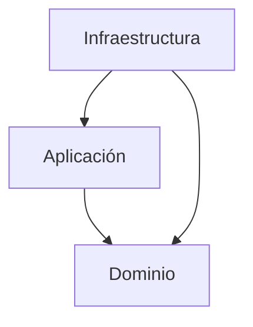

# Smart Help Desk API
API empresarial para administrar solicitudes
de soporte técnico.
## Tecnologías
- Java 21
- Spring Boot 3.5.16
- Gradle 8.14.3
- Spring Web
- Spring Validation
- JUnit 5
## Arquitectura hexagonal
El proyecto utiliza arquitectura hexagonal
para separar las reglas de negocio
de los detalles de infraestructura.
### Domain
Contiene las reglas de negocio,
objetos de valor, modelos y contratos.
No depende de Spring Boot ni de JPA.
### Application
Contiene los casos de uso que coordinan
las operaciones del sistema.
### Infrastructure
Contiene la configuración de Spring Boot
y los futuros adaptadores HTTP y de persistencia.
### Shared
Contendrá elementos técnicos compartidos.
## Dirección de dependencias
Infrastructure -> Application -> Domain
Las capas internas no deben depender
de las implementaciones externas.
## Día 1
Se implementaron:
- Estructura inicial del proyecto.
- Arquitectura hexagonal.
- InvalidValueException.
- EmailAddress.
- FullName.
- Pruebas unitarias con JUnit 5.
## Pruebas
Ejecutar en Windows:
.\gradlew.bat clean test
Resultado verificado:
9 pruebas exitosas y 0 fallidas.
## Ejecución
Ejecutar la clase:
SmarthelpdeskApplication
Servidor local:
http://localhost:8080

## Diagrama de arquitectura

La infraestructura contiene los adaptadores
y la configuración técnica.
La aplicación coordina los casos de uso.
El dominio contiene las reglas del negocio
y no depende de Spring Boot ni de JPA.

## Día 2 - Modelado orientado a objetos

Se implementó el agregado Ticket utilizando

encapsulamiento y comportamiento de dominio.

### Clases y objetos de valor

- Ticket

- TicketId

- UserId

- CategoryId

- TicketStatus

- TicketPriority

### Reglas de negocio

- Un ticket se crea en estado OPEN.

- El ticket tiene identidad única mediante UUID.

- El asunto y la descripción son obligatorios.

- La prioridad no puede ser nula.

- No se permite modificar un ticket cerrado.

- Los cambios actualizan updatedAt.

- createdAt permanece inmutable.

### Decisiones de diseño

Ticket es una entidad y utiliza una clase final

porque tiene identidad y estado que puede cambiar.

TicketId es un objeto de valor implementado

mediante record porque es inmutable.

Se evitan setters públicos para proteger

las invariantes del dominio.

### Pruebas

Ejecutar:

.\gradlew.bat clean test

```
## Día 3 - Usuarios, colecciones y repositorios en memoria

### Implementaciones

- Entidad User.

- Enum RoleName.

- Gestión de roles mediante Set.

- Activación y desactivación de usuarios.

- UserRepositoryPort.

- InMemoryUserRepositoryAdapter.

- Entidad Category.

- CategoryRepositoryPort.

- InMemoryCategoryRepositoryAdapter.

### Decisiones técnicas

Se utiliza Set para evitar roles duplicados.

Se utiliza ConcurrentHashMap para almacenar

usuarios y categorías temporalmente.

Los puertos definen contratos independientes

de la tecnología de persistencia.

Los adaptadores implementan esos contratos.

Los nombres de categorías se comparan

sin distinguir mayúsculas y minúsculas.

### Pruebas

35 pruebas ejecutadas correctamente.

0 pruebas fallidas.

Comando:

.\gradlew.bat clean test
 