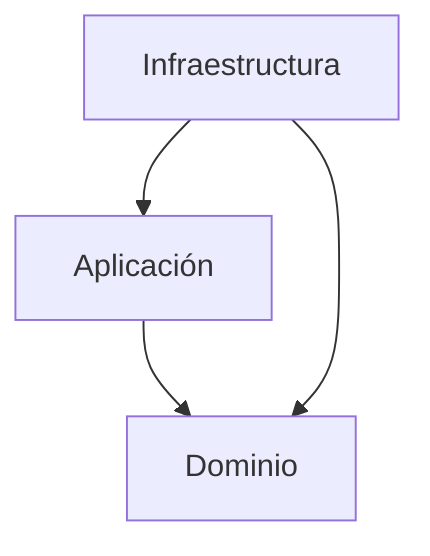

# Smart Help Desk API
API empresarial para administrar solicitudes
de soporte técnico.
## Tecnologías
- Java 21
- Spring Boot 3.5.16
- Gradle 8.14.3
- Spring Web
- Spring Validation
- JUnit 5
## Arquitectura hexagonal
El proyecto utiliza arquitectura hexagonal
para separar las reglas de negocio
de los detalles de infraestructura.
### Domain
Contiene las reglas de negocio,
objetos de valor, modelos y contratos.
No depende de Spring Boot ni de JPA.
### Application
Contiene los casos de uso que coordinan
las operaciones del sistema.
### Infrastructure
Contiene la configuración de Spring Boot
y los futuros adaptadores HTTP y de persistencia.
### Shared
Contendrá elementos técnicos compartidos.
## Dirección de dependencias
Infrastructure -> Application -> Domain
Las capas internas no deben depender
de las implementaciones externas.
## Día 1
Se implementaron:
- Estructura inicial del proyecto.
- Arquitectura hexagonal.
- InvalidValueException.
- EmailAddress.
- FullName.
- Pruebas unitarias con JUnit 5.
## Pruebas
Ejecutar en Windows:
.\gradlew.bat clean test
Resultado verificado:
9 pruebas exitosas y 0 fallidas.
## Ejecución
Ejecutar la clase:
SmarthelpdeskApplication
Servidor local:
http://localhost:8080

## Diagrama de arquitectura

La infraestructura contiene los adaptadores
y la configuración técnica.
La aplicación coordina los casos de uso.
El dominio contiene las reglas del negocio
y no depende de Spring Boot ni de JPA.